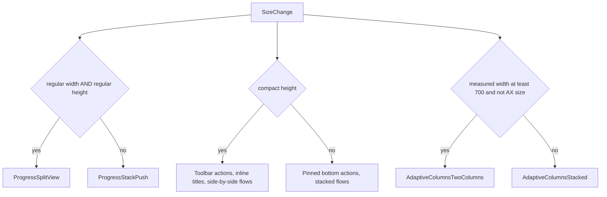

# TrackBoth adaptive layout: landscape, resizable iPad, and iPhone Duo

This plan is written for an implementing agent. Do the phases in order. Commit at the end of each phase. Do not skip a phase's verification. When something here doesn't match the code, stop and write it in the progress log at the bottom of the copied plan (see Phase 0). Don't guess.

Repo: `/Users/jrozell/Desktop/personal/TrackBoth`. The app code is in `TrackBoth/TrackBoth/`, and `project.yml` is at [TrackBoth/TrackBoth/project.yml](/Users/jrozell/Desktop/personal/TrackBoth/TrackBoth/project.yml).

**Assumption:** this lands before 1.0 ships and replaces decision D6 ("1.0 is iPhone portrait only"). Once a version with iPad support is on the App Store, every later update has to keep supporting iPad.

---

## 1. Why landscape is a mess today (audit)

Read this list first. Each phase below fixes items from it.

1. **Config.** `project.yml` sets `TARGETED_DEVICE_FAMILY: "1"` and portrait as the only iPhone orientation. On iPad the app runs letterboxed in iPhone compatibility mode. The iPhone Duo inner display opens in landscape (2853×2007 in PuzzleBuddy's capture script), so a portrait-only app comes out wrong there.
2. **Urge "ride" step** ([UrgeFlowView.swift](/Users/jrozell/Desktop/personal/TrackBoth/TrackBoth/Features/Urge/UrgeFlowView.swift) lines 126–131). It uses `ViewThatFits(in: .vertical)` inside a `ScrollView`. A scroll view offers unlimited height, so the stacked layout always "fits" and the fallback never runs. If the fallback did run, it would put 9 items (intro, circle, clock, +5 min, plan, reasons, chips, two buttons) in one `HStack`.
3. **Urge nesting is backwards.** `ReadableColumn { ScrollView { ... } }` means only the middle 640pt can scroll. Every other screen does `ScrollView { ReadableColumn { ... } }`.
4. **Fixed bottom spacers** take height that landscape doesn't have: `Color.clear.frame(height: 72)` in [MetricDetailScreen.swift](/Users/jrozell/Desktop/personal/TrackBoth/TrackBoth/Features/Progress/MetricDetailScreen.swift) line 44, and `Color.clear.frame(height: 88)` in [SettingsScreen.swift](/Users/jrozell/Desktop/personal/TrackBoth/TrackBoth/Features/Settings/SettingsScreen.swift) line 52.
5. **Pinned bottom actions** fill a landscape screen that is about 390pt tall: CheckIn "Done", Slip "Save", the Today SOS button, and the Onboarding controls (Primary + Secondary + Back, about 170pt). On iPad, CheckIn Done, Slip Save, and the Onboarding controls stretch across the whole window because nothing caps their width.
6. **Large navigation titles** on Today keep using vertical space in landscape.
7. **Progress** is a plain `NavigationStack`. On iPad and on the Duo inner display it's a stretched list followed by a pushed detail.
8. **Wide screens get one 640pt column** everywhere. Today and Metric Detail don't use the extra width.
9. **Celebration and Lock** are fixed `VStack`s with no scroll, so they can clip in landscape at accessibility text sizes.
10. **DayEditorSheet** allows only the `.medium` detent.
11. **Sheets** use default sizing on iPad. Nothing uses `presentationSizing`.
12. **There are no layout tests**, and there's no way to launch the app in landscape for screenshots.

---

## 2. Layout rules (source of truth)

These rules follow PuzzleBuddy ([PuzzleBuddy/App/Util/AdaptiveLayout.swift](/Users/jrozell/Desktop/personal/PuzzleBuddy/App/Util/AdaptiveLayout.swift), [PuzzleBuddy/ongoing/iphone-duo-1.1.0.md](/Users/jrozell/Desktop/personal/PuzzleBuddy/ongoing/iphone-duo-1.1.0.md)) and DartBuddy ([DartBuddy/DesignSystem/Components/GameplayLayout.swift](/Users/jrozell/Desktop/personal/DartBuddy/DesignSystem/Components/GameplayLayout.swift), and the landscape split in `DartBuddy/Features/Play/Shared/MatchSummaryScreen.swift`).

There are three independent signals:

- **Navigation split**: `horizontalSizeClass == .regular && verticalSizeClass == .regular`. This covers iPad full screen, iPad 1/2 or 2/3 Split View on larger iPads, a tall Stage Manager window, and the Duo inner display. iPhone Pro Max in landscape is regular width with compact height, so it does **not** split.
- **Short height**: `verticalSizeClass == .compact`. This covers any iPhone in landscape (Pro Max included), Duo outer in landscape, and short Stage Manager windows. Short height moves pinned actions into the toolbar, uses inline titles, and puts full-screen flows side by side (the DartBuddy summary pattern).
- **Two content columns**: the **measured width** of the content is at least 700pt and the text size is not an accessibility size. Use measured width here, not size classes, because sheets, Stage Manager windows, and the Duo report size classes that don't match their real width.

Hard rules (these continue §8.7 of `Specs/DesignSystemSpec.md`):

- Never use `UIDevice.current.userInterfaceIdiom`, `UIScreen.main.bounds`, or interface orientation in **app** code. UI tests may check idiom.
- Keep every `@State` on the screen struct, not inside a branch subview. Rotating, resizing, or folding switches branches, and switching branches would reset state that lives inside them.
- Keep every accessibility identifier. When a button moves to the toolbar, the toolbar button keeps the same identifier.
- Don't touch Domain, Data, copy (`RecoveryCopy`), or view-model logic.
- Keep the root `TabView` with its current `.tabItem` API. Do **not** adopt PuzzleBuddy's `.sidebarAdaptable` switching. With 3 tabs a sidebar adds little. Switching styles rebuilds tab content on a fold or resize, which would drop open sheets and drafts. iPadOS shows the top tab bar on its own.



Expected result on each device:

- iPhone portrait (compact width, regular height): the current 1.0 layout. One column, pinned actions.
- iPhone landscape, including Pro Max (compact height): short chrome, two content columns on Today and Detail, side-by-side Urge, Onboarding, and Celebration, and a Progress list that pushes the detail.
- iPad full screen in either orientation, and the Duo inner display (regular/regular): Progress split view, two columns, form and page sheets, and capped widths on every button.
- iPad 1/3 Split View, Slide Over, and Duo outer folded (compact width, regular height): the same as iPhone portrait.
- Stage Manager resizing: moves smoothly through the cases above with no crash and no state loss.

---

## Phase 0: Prep (no code changes)

1. `cd /Users/jrozell/Desktop/personal/TrackBoth && git status`. Today the only change is `TrackBoth/TrackBoth.xcodeproj/project.pbxproj`, and it has build number **7**, but `project.yml` still says `CURRENT_PROJECT_VERSION: 6`. Running `xcodegen generate` sets it back to 6. Ask the owner which build number they want before regenerating. If they want 7, set `CURRENT_PROJECT_VERSION: 7` in `project.yml`.
2. Work on the current branch (`claude/dazzling-albattani-7mg4uh`) unless the owner names a different one.
3. Copy this plan to `ongoing/adaptive-layout-plan.md`, add a progress-log table at the bottom, and add a row to [ongoing/README.md](/Users/jrozell/Desktop/personal/TrackBoth/ongoing/README.md) under Active.
4. Record a baseline: `cd TrackBoth && xcodegen generate`, then run unit tests: `xcodebuild test -project TrackBoth.xcodeproj -scheme TrackBoth -destination 'platform=iOS Simulator,name=iPhone 17' -only-testing:TrackBothTests CODE_SIGNING_ALLOWED=NO`. Write the pass count in the log.
5. Check for simulators: `xcrun simctl list devices available | rg -i "duo|ipad|iphone 17"`. Today the machine has iPhone 17, iPhone 17 Pro Max, iPad mini (A17 Pro), iPad Air 11/13 (M3), iPad Pro 11/13 (M4), and **no iPhone Duo**. Run `xcrun simctl list devicetypes | rg -i duo`. If the device type exists, create one with `xcrun simctl create "iPhone Duo" "<device type id>"`. If it doesn't exist, log "Duo sim unavailable" and do the Duo checks in Phase 8 on the regular/regular and compact-height proxies.
6. If you use XcodeBuildMCP, call `session_show_defaults` before the first build, and set the project to `TrackBoth/TrackBoth/TrackBoth.xcodeproj` with scheme `TrackBoth`.

---

## Phase 1: Foundation (config, helpers, landscape launch, unit tests)

### 1.1 `project.yml` (target `TrackBoth`, `settings.base`)

Replace the single iPhone orientation line and the device family with:

```yaml
        TARGETED_DEVICE_FAMILY: "1,2"
        INFOPLIST_KEY_UIRequiresFullScreen: NO
        INFOPLIST_KEY_UISupportedInterfaceOrientations_iPhone:
          - UIInterfaceOrientationPortrait
          - UIInterfaceOrientationLandscapeLeft
          - UIInterfaceOrientationLandscapeRight
        INFOPLIST_KEY_UISupportedInterfaceOrientations_iPad:
          - UIInterfaceOrientationPortrait
          - UIInterfaceOrientationPortraitUpsideDown
          - UIInterfaceOrientationLandscapeLeft
          - UIInterfaceOrientationLandscapeRight
```

Don't add a multiple-scenes key. The app stays single-scene. Don't add orientation keys to `Resources/TrackBoth-Info.plist`.

### 1.2 New file `TrackBoth/DesignSystem/AdaptiveLayout.swift`

```swift
import SwiftUI

enum AdaptiveLayout {
    static let textColumnWidth: CGFloat = 640
    static let wideColumnWidth: CGFloat = 1_040
    static let twoColumnMinWidth: CGFloat = 700
    static let sideColumnWidth: CGFloat = 300

    /// iPad, iPhone Duo inner display, and tall resizable windows. Pro Max landscape is
    /// regular width but compact height, so it keeps the phone stack.
    static func usesSplitNavigation(horizontal: UserInterfaceSizeClass?, vertical: UserInterfaceSizeClass?) -> Bool {
        horizontal == .regular && vertical == .regular
    }

    /// iPhone landscape (including Pro Max), Duo outer landscape, short Stage Manager windows.
    static func isShortHeight(vertical: UserInterfaceSizeClass?) -> Bool {
        vertical == .compact
    }

    /// Measured width, not size class: sheets and resizable windows misreport width.
    static func usesTwoColumns(width: CGFloat, dynamicType: DynamicTypeSize) -> Bool {
        width >= twoColumnMinWidth && !dynamicType.isAccessibilitySize
    }

    static func breathingDiameter(vertical: UserInterfaceSizeClass?) -> CGFloat {
        isShortHeight(vertical: vertical) ? 180 : 280
    }
}
```

### 1.3 Update [ReadableColumn.swift](/Users/jrozell/Desktop/personal/TrackBoth/TrackBoth/DesignSystem/Components/ReadableColumn.swift)

Add a width option. Existing call sites must keep compiling unchanged.

```swift
struct ReadableColumn<Content: View>: View {
    enum Width { case text, wide }

    var width: Width
    var content: () -> Content

    init(width: Width = .text, @ViewBuilder content: @escaping () -> Content) {
        self.width = width
        self.content = content
    }

    var body: some View {
        content()
            .frame(maxWidth: width == .text ? AdaptiveLayout.textColumnWidth : AdaptiveLayout.wideColumnWidth)
            .frame(maxWidth: .infinity)
            .padding(.horizontal, Spacing.l)
    }
}
```

### 1.4 New file `TrackBoth/DesignSystem/Components/AdaptiveColumns.swift`

```swift
import SwiftUI

struct AdaptiveColumns<Leading: View, Trailing: View>: View {
    var spacing: CGFloat = Spacing.l
    @ViewBuilder var leading: () -> Leading
    @ViewBuilder var trailing: () -> Trailing

    @Environment(\.dynamicTypeSize) private var dynamicTypeSize
    @State private var width: CGFloat = 0

    var body: some View {
        Group {
            if AdaptiveLayout.usesTwoColumns(width: width, dynamicType: dynamicTypeSize) {
                HStack(alignment: .top, spacing: spacing) {
                    VStack(alignment: .leading, spacing: spacing) { leading() }
                        .frame(maxWidth: .infinity, alignment: .topLeading)
                    VStack(alignment: .leading, spacing: spacing) { trailing() }
                        .frame(maxWidth: .infinity, alignment: .topLeading)
                }
            } else {
                VStack(alignment: .leading, spacing: spacing) {
                    leading()
                    trailing()
                }
            }
        }
        .frame(maxWidth: .infinity, alignment: .leading)
        .onGeometryChange(for: CGFloat.self) { $0.size.width } action: { width = $0 }
    }
}
```

Add Light, Dark, AX3, and Landscape previews like the other components have.

### 1.5 Sheet and list helpers (append to `AdaptiveLayout.swift`)

```swift
extension View {
    /// iPad and Duo inner: centered form sheet. iPhone: ignored.
    func adaptiveFormSheet() -> some View { presentationSizing(.form) }

    /// iPad and Duo inner: near-full page sheet for content that uses two columns.
    func adaptivePageSheet() -> some View { presentationSizing(.page) }

    /// Insets List rows to the readable width on wide windows without clipping the scroll area.
    func readableListMargins() -> some View { modifier(ReadableListMargins()) }
}

private struct ReadableListMargins: ViewModifier {
    @State private var width: CGFloat = 0

    func body(content: Content) -> some View {
        content
            .contentMargins(.horizontal, max(0, (width - AdaptiveLayout.textColumnWidth) / 2), for: .scrollContent)
            .onGeometryChange(for: CGFloat.self) { $0.size.width } action: { width = $0 }
    }
}
```

### 1.6 Landscape launch for screenshots and self-checks

Port [PuzzleBuddy/App/Util/SnapshotOrientationLock.swift](/Users/jrozell/Desktop/personal/PuzzleBuddy/App/Util/SnapshotOrientationLock.swift) as-is to `TrackBoth/Support/SnapshotOrientationLock.swift`. Then wire it up:

- In [AppDelegate.swift](/Users/jrozell/Desktop/personal/TrackBoth/TrackBoth/App/AppDelegate.swift) `didFinishLaunching`, call `SnapshotOrientationLock.configureFromLaunchArguments()`. Add:

```swift
    func application(_ application: UIApplication, supportedInterfaceOrientationsFor window: UIWindow?) -> UIInterfaceOrientationMask {
        SnapshotOrientationLock.mask
    }
```

- In [RootView.swift](/Users/jrozell/Desktop/personal/TrackBoth/TrackBoth/App/RootView.swift), call `SnapshotOrientationLock.applyIfNeeded()` at the top of the existing `.task`.
- With this in place, you can check landscape yourself: launch with `-snapshot_orientation landscape` plus the existing args, then take a screenshot. Because of the multitasking setting from 1.1, iPad ignores the lock. On iPad, rotate with Simulator > Device > Rotate Left, or use `XCUIDevice` in a UI test.

### 1.7 Unit tests: new `TrackBoth/Tests/Unit/AdaptiveLayoutTests.swift` (XCTest, like the other tests)

Mirror [PuzzleBuddy/AppTests/AdaptiveLayoutTests.swift](/Users/jrozell/Desktop/personal/PuzzleBuddy/AppTests/AdaptiveLayoutTests.swift):

- `usesSplitNavigation` is true only for regular/regular. Check all four combinations, plus `nil`.
- `isShortHeight` is true for compact vertical with either horizontal class.
- `usesTwoColumns` is false at 699, true at 700, and false at 1,200 with `.accessibility1`.
- `breathingDiameter` is 180 for compact height and 280 otherwise.

### 1.8 Verify and commit

- Run `xcodegen generate` from `TrackBoth/TrackBoth`, build, and run unit tests (all green, with the 4 new tests).
- Launch on iPhone 17 with `-ui_testing -skip_onboarding -seed_demo -snapshot_orientation landscape` and confirm the app is in landscape. The layout will still look wrong at this point.
- Commit: `Enable iPhone landscape and iPad with adaptive layout helpers.`

---

## Phase 2: Shared chrome (pinned actions, spacers, sheets, centered screens)

### 2.1 Pattern: move the pinned action into the toolbar at short height

This is the PuzzleBuddy `PuzzleForm.pinsSaveInToolbar` pattern. Apply it to **CheckInSheet** and **SlipFlowView**.

- Add `@Environment(\.verticalSizeClass) private var verticalSizeClass` and `private var pinsActionInToolbar: Bool { AdaptiveLayout.isShortHeight(vertical: verticalSizeClass) }`.
- When `pinsActionInToolbar` is false: keep the bottom `PrimaryButton`, but wrap it in `ReadableColumn { ... }`. Remove its own `.padding(.horizontal, Spacing.l)`, because the column already pads. This caps the width on iPad (audit item 5).
- When it's true: don't render the bottom button. Add `ToolbarItem(placement: .confirmationAction)` with a plain `Button` that has the same title, the same action, the same `.disabled(...)`, and the **same** `.accessibilityIdentifier` (`checkIn.done`, `slip.save`).
- In [CheckInSheet.swift](/Users/jrozell/Desktop/personal/TrackBoth/TrackBoth/Features/CheckIn/CheckInSheet.swift), the title switches between Done and Back to Today. Keep that logic in both places by moving it into a `doneTitle(model)` helper.
- In [SlipFlowView.swift](/Users/jrozell/Desktop/personal/TrackBoth/TrackBoth/Features/Slip/SlipFlowView.swift), the summary state has no Save. Show the toolbar item only when `model?.summary == nil`.

### 2.2 Remove fixed bottom spacers

- `MetricDetailScreen`: delete the outer `VStack(spacing: 0)` and the `Color.clear.frame(height: 72)`. The `ScrollView` becomes the root, and the `.background`, title, toolbar, and sheets stay on it.
- `SettingsScreen`: delete the `VStack(spacing: 0)`, the `Color.clear.frame(height: 88)`, and its comment. The `List` becomes the root.
- Check: with seeded data, scroll to the bottom on iPhone 17 portrait. The last row must clear the tab bar. If it doesn't, add `.contentMargins(.bottom, Spacing.xl, for: .scrollContent)` to that scroll view. Don't add a fixed spacer back.

### 2.3 Sheet sizing (add the modifier at the end of each sheet's own `body`)

- `CheckInSheet`, `SlipFlowView`, `MetricFormView`, `DayEditorSheet`, `CelebrationView`, `CrisisResourcesView` (when it's shown as a sheet from Slip): `.adaptiveFormSheet()`.
- The metric detail sheet that Today opens (`TodayScreen` `.detail` case: `NavigationStack { MetricDetailScreen(...) }`): add `.adaptivePageSheet()` to that `NavigationStack` inside the sheet closure. Don't add it to `MetricDetailScreen`, because the same screen is also pushed.
- `DayEditorSheet`: change `.presentationDetents([.medium])` to `.presentationDetents([.medium, .large])`. Wrap the `ReadableColumn` in `ScrollView` and add `.scrollBounceBehavior(.basedOnSize)`.

### 2.4 Lists on wide windows

- `SettingsScreen` `List` and `CrisisResourcesView` `List`: add `.readableListMargins()`.

### 2.5 Centered, scrollable full screens: Celebration, Lock, PrivacyCover

- [CelebrationView.swift](/Users/jrozell/Desktop/personal/TrackBoth/TrackBoth/Features/Celebration/CelebrationView.swift): put the content in `ScrollView { ReadableColumn { ... } }`, then add `.scrollBounceBehavior(.basedOnSize)` and `.defaultScrollAnchor(.center, for: .alignment)` (iOS 18) so short content stays centered.
- At short height (read `verticalSizeClass`), lay the content out as `HStack(alignment: .center, spacing: Spacing.xl)`: the big number on the left; message, reason, and `PrimaryButton` in a `VStack` on the right. This is DartBuddy's "celebration | cards" landscape split. Keep the `.trackBothCelebration` and `.onAppear` modifiers on the outer container so they don't reset.
- [LockScreen.swift](/Users/jrozell/Desktop/personal/TrackBoth/TrackBoth/Features/Lock/LockScreen.swift) `LockScreen`: use the same `ScrollView` and center anchor, and wrap the content in `ReadableColumn`. Change the background to `.background(Color.tbBackground.ignoresSafeArea())`. Do the same background change on `PrivacyCover`. On the Duo the status bar sits on the trailing edge, and these covers must hide everything.

### 2.6 Verify and commit

- Unit tests green. Existing UI tests still pass on iPhone 17 portrait: `testCheckInMarksVicesFree` and `testSlipFlowShowsCompassionateSummary`.
- Screenshots (save to `tmp/adaptive-qa/phase2/`, which is gitignored), all with `-ui_testing -skip_onboarding -seed_demo`:
  - Check-in in landscape: `-present_checkin -snapshot_orientation landscape`.
  - Slip in landscape: `-present_slip -snapshot_orientation landscape`.
  - Settings in landscape: `-tab_settings -snapshot_orientation landscape`.
  - Check-in in iPad Air 11 portrait.
- Commit: `Adapt sheets, pinned actions, and full-screen covers for landscape and iPad.`

---

## Phase 3: Today

File: [TodayScreen.swift](/Users/jrozell/Desktop/personal/TrackBoth/TrackBoth/Features/Today/TodayScreen.swift). Also touches [TodayChrome.swift](/Users/jrozell/Desktop/personal/TrackBoth/TrackBoth/Features/Today/TodayChrome.swift).

1. Add `@Environment(\.verticalSizeClass) private var verticalSizeClass`.
2. Change `ReadableColumn {` to `ReadableColumn(width: .wide) {`.
3. Move the two section blocks into private computed views, `quittingSection` and `buildingSection`. Each returns its `VStack` with the `SectionHeader`. Then:

```swift
if !model.vices.isEmpty && !model.habits.isEmpty {
    AdaptiveColumns { quittingSection } trailing: { buildingSection }
} else {
    if !model.vices.isEmpty { quittingSection }
    if !model.habits.isEmpty { buildingSection }
}
```

4. The yesterday prompt, check-in banner, and empty state stay above the columns at full column width. Cap each at the text width with `.frame(maxWidth: AdaptiveLayout.textColumnWidth, alignment: .leading)` so a 1,040pt banner doesn't look stretched.
5. Change the title mode to `.navigationBarTitleDisplayMode(AdaptiveLayout.isShortHeight(vertical: verticalSizeClass) ? .inline : .large)`.
6. SOS stays pinned at the bottom, because the urge flow must stay 2 taps away. In `SOSButton`, add `var isCompact = false`. When it's true, use `.padding(.top, Spacing.xs)` and `.padding(.bottom, Spacing.xs)`. Today passes `isCompact: AdaptiveLayout.isShortHeight(vertical: verticalSizeClass)`. It already caps itself at 640, so leave that alone.
7. Keep `@State sheet`, `model`, and `dismissedYesterday` where they are, on `TodayScreen`.

Verify with screenshots on iPhone 17 portrait (unchanged from today), iPhone 17 landscape (Quitting | Building side by side, inline title, SOS visible), iPhone 17 Pro Max landscape, iPad Air 11 landscape, and AX3 portrait and landscape (AX3 must stay one column). Commit: `Lay out Today in two columns on wide screens and tighten short-height chrome.`

---

## Phase 4: Progress split view and Metric Detail columns

### 4.1 [ProgressScreen.swift](/Users/jrozell/Desktop/personal/TrackBoth/TrackBoth/Features/Progress/ProgressScreen.swift): one `NavigationSplitView` at every size (the PuzzleBuddy `PuzzleList` pattern)

- Remove `@State private var path = NavigationPath()`. Add `@State private var selection: UUID?` along with `horizontalSizeClass` and `verticalSizeClass` from the environment.
- Use this structure:

```swift
NavigationSplitView {
    List(selection: $selection) { /* existing sections; NavigationLink(value: card.id) stays */ }
        .scrollContentBackground(.hidden)
        .background(Color.tbBackground)
        .navigationTitle("Progress")
        .toolbar { /* existing EditButton + plus */ }
} detail: {
    if let id = selection, let metric = metrics.first(where: { $0.id == id }) {
        MetricDetailScreen(metric: metric)
            .id(metric.id)
    } else {
        ContentUnavailableView(RecoveryCopy.pickSomethingTitle, systemImage: "chart.line.uptrend.xyaxis")
            .accessibilityIdentifier(AccessibilityIdentifiers.progressDetailPlaceholder)
    }
}
.navigationSplitViewStyle(.balanced)
.environment(\.horizontalSizeClass, AdaptiveLayout.usesSplitNavigation(horizontal: horizontalSizeClass, vertical: verticalSizeClass) ? horizontalSizeClass : .compact)
```

- The `.id(metric.id)` is required. Without it, `MetricDetailScreen`'s `@State` (`planText`, `newReason`, the model) carries over when you pick a different metric.
- Delete `.navigationDestination(for: UUID.self)`. The split view's `List(selection:)` with `NavigationLink(value:)` handles pushing when collapsed and showing the detail column when split.
- `openFirstDetailIfNeeded()`: set `selection = id` instead of `path.append(id)`.
- Add `.onChange(of: metrics.map(\.id))`: if `selection` isn't in the list anymore (the metric was deleted), set `selection = nil`.
- Add `pickSomethingTitle` ("Pick something to see its progress") to `RecoveryCopy`, and `progressDetailPlaceholder = "progress.detailPlaceholder"` to [AccessibilityIdentifiers.swift](/Users/jrozell/Desktop/personal/TrackBoth/TrackBoth/Support/AccessibilityIdentifiers.swift).
- Check that EditButton reordering still works with `List(selection:)` on both iPhone and iPad. If edit mode shows selection circles or blocks `.onMove`, log it and stop. Don't hack around it.

### 4.2 [MetricDetailScreen.swift](/Users/jrozell/Desktop/personal/TrackBoth/TrackBoth/Features/Progress/MetricDetailScreen.swift): two columns

- Change to `ReadableColumn(width: .wide)`. `header` stays full width at the top.
- **Vice**: `AdaptiveColumns { statTiles; calendar } trailing: { reasonsSection; planSection; patterns (if any); urgeLine (if any) }`.
- **Habit**: `AdaptiveColumns { statTiles } trailing: { calendar }`.
- Pull the existing `LazyVGrid` of `StatTile`s out into `private var statTiles`. Keep the `adaptive(minimum: 140)` grid.
- `planText`, `newReason`, `sheet`, and `pendingSlip` stay on the screen struct.

### 4.3 Verify and commit

- iPhone 17 portrait: list, push, back. This must work exactly as it does today, including `testEditPastDayToSlipUpdatesStats` if it exists.
- iPhone 17 landscape and Pro Max landscape: still a pushed stack, with no empty detail column.
- iPad Air 11 portrait and landscape: sidebar list, a placeholder on first load, tapping a card shows the detail beside the list, and the vice detail shows two columns.
- iPad mini portrait in 1/3 Split View: collapses to a stack.
- Launch with `-tab_progress -open_first_detail` on both iPhone and iPad.
- Commit: `Split Progress into list and detail on regular screens and use two detail columns.`

---

## Phase 5: Urge flow

File: [UrgeFlowView.swift](/Users/jrozell/Desktop/personal/TrackBoth/TrackBoth/Features/Urge/UrgeFlowView.swift). This is the most important screen to get right in landscape.

1. **Fix the nesting** (audit item 3). The body becomes:

```swift
NavigationStack {
    Group {
        if let model {
            if model.step == .ride && AdaptiveLayout.isShortHeight(vertical: verticalSizeClass) {
                rideSideBySide(model)
            } else {
                ScrollView {
                    ReadableColumn { content(model) }
                        .padding(.vertical, Spacing.l)
                }
            }
        }
    }
    .frame(maxWidth: .infinity, maxHeight: .infinity, alignment: .top)
    .background(Color.tbCalm.ignoresSafeArea())
    // existing navigationBarTitleDisplayMode, toolbar, confirmationDialog, sheet unchanged
}
```

2. **Delete** `ride(_:)` with its `ViewThatFits(in: .vertical)` (audit item 2). In the non-short branch, `content(model)` for `.ride` calls `VStack(spacing: Spacing.l) { rideFocus(model); rideSupport(model) }`.
3. Split `rideBody` into two builders:
   - `rideFocus(model)`: `BreathingCircle`, the `TimelineView` clock, and the "Add five minutes" button.
   - `rideSupport(model)`: intro text, plan, `reasons`, `habitChips`, the "urge passed" `PrimaryButton`, and the "I slipped" button.
4. `rideSideBySide(model)` (the DartBuddy board | pad pattern):

```swift
HStack(alignment: .top, spacing: Spacing.l) {
    VStack(spacing: Spacing.m) { rideFocus(model) }
        .frame(maxWidth: .infinity, maxHeight: .infinity)
    ScrollView {
        VStack(alignment: .leading, spacing: Spacing.l) { rideSupport(model) }
            .padding(.vertical, Spacing.m)
    }
    .scrollBounceBehavior(.basedOnSize)
    .frame(maxWidth: .infinity)
}
.padding(.horizontal, Spacing.l)
```

5. [BreathingCircle.swift](/Users/jrozell/Desktop/personal/TrackBoth/TrackBoth/DesignSystem/Components/BreathingCircle.swift): add `var maxDiameter: CGFloat = 280` and use it in `.frame(maxWidth: maxDiameter, maxHeight: maxDiameter)`. `UrgeFlowView` passes `AdaptiveLayout.breathingDiameter(vertical: verticalSizeClass)`.
6. The other steps (`.choose`, `.intensity`, `.passed`) stay single-column inside the scroll view. They're short lists that scroll fine.
7. `model`, `showSlip`, `askClose`, and `reasonIndex` stay on the view. Rotating in the middle of the ride must not restart the timer, because the timer's end time lives in `UrgeViewModel`.

Verify with screenshots: `-present_urge -snapshot_orientation landscape` on iPhone 17 (pick Alcohol, intensity 3, then capture the ride step), the same on Pro Max, iPad Air 11 landscape (stacked, centered 640 column), and AX3 landscape (two panes that each scroll). Then rotate in the middle of the ride: the clock keeps counting down. Run `testUrgeFlowResisted` in portrait. Commit: `Put the urge ride side by side at short height and fix its scroll nesting.`

---

## Phase 6: Onboarding

File: [OnboardingFlow.swift](/Users/jrozell/Desktop/personal/TrackBoth/TrackBoth/Features/Onboarding/OnboardingFlow.swift).

1. Pull the paging `TabView` (with its modifiers) out into `private var pager: some View`.
2. Body:

```swift
Group {
    if AdaptiveLayout.isShortHeight(vertical: verticalSizeClass) {
        VStack(spacing: Spacing.s) {
            progress
            HStack(alignment: .top, spacing: Spacing.l) {
                pager.frame(maxWidth: .infinity)
                ScrollView { controls.padding(.top, Spacing.s) }
                    .scrollBounceBehavior(.basedOnSize)
                    .frame(width: AdaptiveLayout.sideColumnWidth)
            }
            .padding(.trailing, Spacing.l)
        }
    } else {
        VStack(spacing: Spacing.l) {
            ReadableColumn { progress }
            pager
            ReadableColumn { controls }
        }
    }
}
.background(Color.tbBackground)
// existing onAppear / onChange stay here
```

3. In `controls`, remove `.padding(.horizontal, Spacing.l)` because `ReadableColumn` pads now. Keep `.padding(.bottom, Spacing.l)`. In the side column, controls stack top-down and keep their identifiers (`onboarding.next`, `onboarding.finish`).
4. In `progress`, remove its own `.padding(.horizontal, Spacing.l)` for the same reason. In the short-height branch, add `.padding(.horizontal, Spacing.l)` back on `progress` there.
5. `welcome`: use `BrandMark(size: isShortHeight ? 48 : 72)`.
6. `model` stays `@State` on `OnboardingFlow`. The text fields bind to it, so rotating mid-entry keeps the text.

Verify: launch with `-ui_testing` and **without** `-skip_onboarding`, plus `-snapshot_orientation landscape`. Walk every page on iPhone 17 landscape: Next and Back must be visible without scrolling at the default text size. Repeat on iPad Air 11 portrait (controls capped at 640) and at AX3 in landscape (the side column scrolls). Also check `-onboarding_vices` in landscape. Commit: `Move onboarding controls to a side column at short height and cap them on iPad.`

---

## Phase 7: Resize and fold hardening (Stage Manager, Split View, iPhone Duo)

1. **iPhone Duo** (only if Phase 0 created the sim):
   - Copy [PuzzleBuddy/Scripts/devicehub-pose.swift](/Users/jrozell/Desktop/personal/PuzzleBuddy/Scripts/devicehub-pose.swift) to `TrackBoth/Scripts/`, and switch poses with `swift Scripts/devicehub-pose.swift closed|open|book`. This needs Device Hub open.
   - Build with the iOS 27.1 SDK. PuzzleBuddy's notes say the full-display and vertical-bar behavior needs it.
   - Folded (outer): you should get the phone portrait layout.
   - Open (inner, landscape): you should get the Progress split and Today in two columns.
   - Look for a white strip along the top or trailing edge (the Duo status bar is on the trailing edge). If there is one, port `BrandWindowBackground` from [PuzzleBuddy/App/Util/SystemNavigationPolicy.swift](/Users/jrozell/Desktop/personal/PuzzleBuddy/App/Util/SystemNavigationPolicy.swift) to `TrackBoth/DesignSystem/WindowBackground.swift`, painting with `UIColor(named: "Background")`, and apply `.background(WindowBackground())` once on `RootView`. Skip this if there's no strip.
2. **Fold and resize with something open.** Each of these must keep the same screen and any typed text:
   - Check-in sheet with one vice marked Free.
   - Urge ride, with the timer still counting.
   - Slip form with a typed note.
   - Metric form (add) with a typed name.
   - Progress with a metric selected. The selection survives going from split to collapsed and back. If the collapsed stack loses the pushed detail when going from split to collapsed, log it as a known SwiftUI limitation. Don't hack around it.
   - Onboarding on the "why" page with typed text.

   Use Duo Open ↔ Closed if available. Otherwise rotate iPhone 17 and resize an iPad window in Stage Manager.
3. **iPad multitasking.** On iPad Air 11 and iPad mini, check Split View at 1/3, 1/2, and 2/3, Slide Over, and Stage Manager (enable it in the sim's Settings > Multitasking & Gestures, then drag-resize a window slowly from smallest to largest). Watch for: layout flipping back and forth at the 700pt line (if you see it, log it, and only then add 20pt of hysteresis to `AdaptiveColumns`), any clipped button, or a tab bar covering content.
4. **Keyboard on iPad.** In landscape on iPad, the Slip note and the MetricDetail reason/plan fields must scroll into view above the keyboard.
5. Commit any fixes: `Harden layouts for Stage Manager resizing and iPhone Duo folds.`

---

## Phase 8: UI tests and QA matrix

### 8.1 New `TrackBoth/Tests/UI/AdaptiveLayoutUITests.swift`

- Use the same launch args as the existing tests: `["-ui_testing", "-skip_onboarding", "-seed_demo"]`.
- Rotate with `XCUIDevice.shared.orientation = .landscapeLeft`, and reset to `.portrait` in `tearDown`. This works on iPhone and iPad (the snapshot lock doesn't apply to iPad).
- Copy the private `tab(named:identifier:in:)` helper from [TrackBothUITests.swift](/Users/jrozell/Desktop/personal/TrackBoth/TrackBoth/Tests/UI/TrackBothUITests.swift) line 104. On iPad the tab bar is at the top, so use the helper and never `app.tabBars` directly.

Tests:

- `testTodayLandscapeKeepsSOSAndCheckInReachable`: after rotating, `today.sosButton` and `today.checkInBanner` are both `isHittable`.
- `testCheckInDoneInToolbarInLandscape`: rotate, open check-in, tap every `checkIn.free.*`, tap `checkIn.done` twice, and check that the banner is gone (same flow as `testCheckInMarksVicesFree`).
- `testCheckInSheetSurvivesRotation`: open check-in in portrait, mark one Free, rotate, and check that `checkIn.done` still exists and that Free is still selected.
- `testUrgeRideInLandscape`: rotate, SOS, Alcohol, `urge.intensity.3`. Then `urge.passed` (swipe up once in the right pane if it's not hittable), then `urge.done`.
- `testSlipSaveInToolbarInLandscape`: rotate, open a vice detail, open the slip sheet, check that `slip.save` is hittable, tap it, and check that `slip.summary` appears.
- `testOnboardingNextReachableInLandscape`: launch without `-skip_onboarding`, rotate, and check that `onboarding.next` is hittable.
- `testProgressSplitOnRegularWidth`: skip unless `UIDevice.current.userInterfaceIdiom == .pad` (`XCTSkipUnless`). Open the Progress tab, check that `progress.detailPlaceholder` exists, tap the first `progress.metricCard.*`, then check that the placeholder is gone and the card list is still on screen.

Run on iPhone 17 and on iPad Air 11 (M3):

`xcodebuild test -project TrackBoth.xcodeproj -scheme TrackBoth -destination 'platform=iOS Simulator,name=iPad Air 11-inch (M3)' -only-testing:TrackBothUITests CODE_SIGNING_ALLOWED=NO`

Don't add iPad to CI. CI only runs unit tests on iPhone 17 today.

### 8.2 New `docs/device-qa-matrix.md`

Model it on [PuzzleBuddy/docs/device-qa-matrix.md](/Users/jrozell/Desktop/personal/PuzzleBuddy/docs/device-qa-matrix.md). Use bullet rows, not tables. One row per screen (Today, Check-in, Urge, Slip, Progress, Metric Detail, Day editor, Metric form, Celebration, Lock, Onboarding, Settings, Crisis resources) for each of these setups:

- iPhone 17 portrait and landscape
- Pro Max landscape
- iPad Air 11 portrait and landscape
- iPad mini Split View 1/3
- Stage Manager resize
- Duo folded, Duo open, and fold mid-flow
- AX3 portrait and landscape
- Dark mode

Fill in the rows you ran, with the date and the result.

Commit: `Add landscape, iPad, and resize UI tests and a device QA matrix.`

---

## Phase 9: Docs and status

- [Specs/DesignSystemSpec.md](/Users/jrozell/Desktop/personal/TrackBoth/Specs/DesignSystemSpec.md) §8.7: rewrite it from "adaptive-ready" to "shipped". Put the three signals from §2 of this plan in it, list `AdaptiveLayout`, `AdaptiveColumns`, `ReadableColumn(width:)`, the sheet helpers, and the "move the action to the toolbar at short height" pattern.
- [Specs/ProductSpec.md](/Users/jrozell/Desktop/personal/TrackBoth/Specs/ProductSpec.md) and [ongoing/recovery-overhaul-plan.md](/Users/jrozell/Desktop/personal/TrackBoth/ongoing/recovery-overhaul-plan.md): change D6 to "iPhone and iPad, portrait and landscape, iPhone Duo-ready". Mark Phase 15 as done by this plan, and add a progress-log row there.
- [README.md](/Users/jrozell/Desktop/personal/TrackBoth/README.md) line 15 and [docs/feature-inventory.md](/Users/jrozell/Desktop/personal/TrackBoth/docs/feature-inventory.md) line 53: change "Later" to shipped.
- Read `/Users/jrozell/Desktop/personal/.cursor/rules/project-status-maintenance.mdc` and update `docs/project-status.md` the way it says.
- App Store follow-up: list it in the ongoing plan, but don't do it here. The 1.0 listing now needs 13" iPad screenshots (2064×2752). Duo screenshots (outer 1398×2034, inner 2853×2007) are optional, for the Duo badge. You can adapt `PuzzleBuddy/Scripts/capture-ipad-marketing-screenshots.sh` and `capture-duo-marketing-screenshots.sh`.
- Commit: `Document adaptive layout rules and update status for iPad and landscape.`
- Push with the personal remote (origin is already `git@github.com-personal:jacobrozell/TrackBoth.git`): `git push origin <branch>`.

---

## Out of scope

- iPad keyboard shortcuts (Phase 15 item 5 of the overhaul plan).
- Multiple windows or scenes, Duo pose and reserved-region APIs, and cover-only Duo UI.
- A sidebar-style tab view.
- Widgets.
- Any change to Domain rules, copy, or data.


## Progress log

| Date | Phase | Result | Notes |
|------|-------|--------|-------|
| 2026-10-31 | 0 | Started | Build 7 in pbxproj; Duo sim available (91C5CAC3). Baseline tests pending. |
